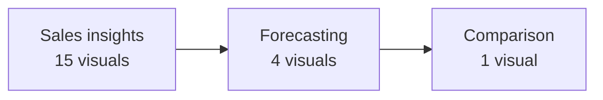

# Superstore Sales Insights: Power BI Dashboard

An interactive Power BI report on retail sales and profit, with a forecasting page and a comparison page. The data is the Superstore retail dataset (the file is named `sales insights(super_store).pbix`).

## Report structure

The report has three pages (read directly from the `.pbix` file):

| Page | Visuals used |
|---|---|
| Sales insights | KPI cards, clustered bar charts, donut chart, map, slicers, stacked area chart, text boxes |
| Forecasting | Line chart, bar chart, text boxes |
| Comparison | Ribbon chart |

## Open it

1. Install [Power BI Desktop](https://powerbi.microsoft.com/desktop/) (Windows).
2. Download `sales insights(super_store).pbix` from this repository.
3. Open the file and use the slicers to filter the report.

## Related

- Python EDA of the same dataset: [Exploratory_Data_Analysis_on_Walmart_sales_data](https://github.com/vrushabh05/Exploratory_Data_Analysis_on_Walmart_sales_data)
- Extended global version with decomposition tree and treemap: [Global_Sales_Insights-and-Future-Forecasting-with-PowerBI](https://github.com/vrushabh05/Global_Sales_Insights-and-Future-Forecasting-with-PowerBI)

## Stack

`Power BI` `DAX` `Power Query`
